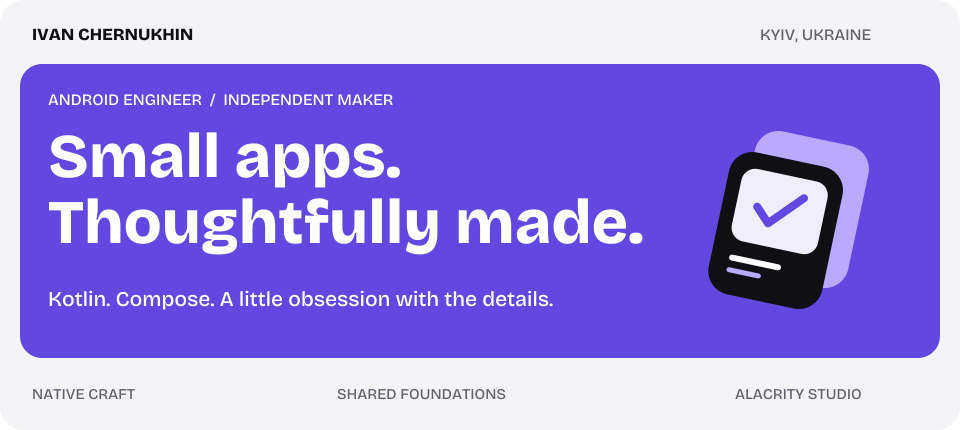

<picture>
  <source media="(prefers-color-scheme: dark)" srcset="assets/hero-dark.svg">
  
</picture>

<p align="center">
  <a href="#the-work">Explore the apps</a> &nbsp; / &nbsp;
  <a href="#under-the-hood">Under the hood</a> &nbsp; / &nbsp;
  <a href="#say-hello">Say hello</a>
</p>

I'm **Ivan**, an Android & Kotlin Multiplatform developer from Ukraine. I build software from the first sketch to the little details you notice after a month of using it.

My independent studio is **[Alacrity](https://alacrity-dev.vercel.app)**. The idea is simple: take one everyday problem, make it easier, and keep the product focused.

## The work

Four different problems. The same care for the experience.

<table>
<tr>
<td width="50%" valign="top">

### 01 · Miria
**Good gifts. Unspoiled surprises.**

Wishlists from any shop, one link to share, and a way for friends to coordinate gifts without giving the surprise away.

[Try the web app ↗](https://miria-xi.vercel.app) · [Google Play ↗](https://play.google.com/store/apps/details?id=com.alacrity.miria)

</td>
<td width="50%" valign="top">

### 02 · Velira
**Teach the lesson. Keep the balance.**

A balance journal for private language tutors: lessons, payments, and a clear answer to “where do we stand?”

[Explore Velira ↗](https://velira-nine.vercel.app)

</td>
</tr>
<tr>
<td width="50%" valign="top">

### 03 · Solia
**Less admin. More behind the lens.**

A booking and shoot-day companion for wedding photographers, bringing jobs, contracts, invoices, and call sheets together.

[Meet the studio ↗](https://alacrity-dev.vercel.app) · [Privacy ↗](https://arch3nemy.github.io/solia-privacy/)

</td>
<td width="50%" valign="top">

### 04 · Liora
**Clear feedback. Clear boundaries.**

Client reviews and scope control for independent creatives: share a version, keep revisions in focus, and agree on extra work.

[Meet the studio ↗](https://alacrity-dev.vercel.app) · [Product details ↗](https://liora-864c6.web.app/terms)

</td>
</tr>
</table>

<details>
<summary><b>Choose your starting point →</b></summary>

- **Planning a gift?** Start with [Miria](https://miria-xi.vercel.app).
- **Teaching private lessons?** Take a look at [Velira](https://velira-nine.vercel.app).
- **Photographing weddings or working with clients?** Explore [Solia and Liora at Alacrity](https://alacrity-dev.vercel.app).
- **Here for the code?** Browse the [studio website source](https://github.com/Arch3nemy/alacrity-site) or my [public repositories](https://github.com/Arch3nemy?tab=repositories).

</details>

## Under the hood

**Kotlin** is home. **Compose** is the canvas. **Multiplatform** connects the pieces.

| Layer | Tools I work with |
| :--- | :--- |
| Interfaces | Jetpack Compose · Figma |
| Shared logic | Kotlin Multiplatform · Coroutines · Flow |
| Data | SQLite · Firebase |
| Foundations | Modular Gradle builds · Git · Java |
| Small helpers | Python |

<details>
<summary><b>01 / What I care about when building</b></summary>

**One clear job.** A small app should earn its place on your phone.

**An interface that explains itself.** Clear states, useful empty screens, and actions that say what will happen.

**Thoughtful data choices.** Collect less, keep data on the device where it makes sense, and explain the tradeoffs.

**Solid foundations.** Shared business logic, deliberate module boundaries, and code that can grow with the product.

</details>

<details>
<summary><b>02 / What I enjoy working on</b></summary>

Turning a rough idea into a usable Android product. Finding the right boundary between shared logic and platform UI. Refining a flow until the next step feels obvious.

I like being involved in the whole thing: product decisions, design, implementation, and the details around a release.

</details>

<details>
<summary><b>03 / A tiny profile.kt</b></summary>

```kotlin
data class Maker(
    val name: String,
    val base: String,
    val toolkit: List<String>,
    val studio: String,
)

val me = Maker(
    name = "Ivan",
    base = "Kyiv, Ukraine",
    toolkit = listOf("Kotlin", "Compose", "Multiplatform"),
    studio = "Alacrity",
)
```

</details>

## Say hello

Have an Android / KMP project in mind, or want to talk about one of the apps?

**[Email me ↗](mailto:ialacritydev@gmail.com)** &nbsp; · &nbsp; [LinkedIn ↗](https://www.linkedin.com/in/vanya-chernukhin-1a180b254/) &nbsp; · &nbsp; [Alacrity ↗](https://alacrity-dev.vercel.app)

---

<p align="center"><sub>Made in Ukraine. Built with care.</sub></p>
